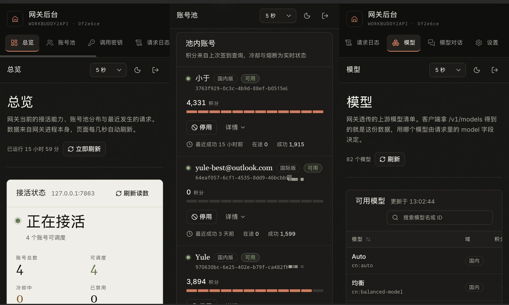

# WorkBuddy2API KernelSU 模块

在 Android 手机上以 KernelSU 模块运行 WorkBuddy2API。网关只监听
`127.0.0.1:7863`，管理后台随服务端二进制一起分发。

上游：Sliverkiss/workbuddy2api -> [YuleBest/workbuddy2api](https://github.com/YuleBest/workbuddy2api) -> [YuleBest/workbuddy2api-magisk](https://github.com/YuleBest/workbuddy2api-magisk)

> [!WARNING]
> 仅限本人已授权账号与本机使用。不要把凭据、管理面板或网关端口暴露给未授权用户。



## 支持范围

- KernelSU，Android 6.0 / API 23 及以上，arm64-v8a
- 内置管理后台与多 key 鉴权
- 账号池、会话粘性、双域模型和 OpenAI 兼容接口
- 签到、活跃上报、旅行、保活、开学季、夜猫子均为 Go 实现
- 自动定时任务默认关闭，可从面板或 CLI 手动触发
- 不包含 Cloudflare Tunnel

## 安装

从 [Releases](https://github.com/YuleBest/workbuddy2api-magisk/releases)
下载 `wb2api-*-arm64-v8a.zip`，刷入 KernelSU 后重启。

本地构建需要 Go、Android NDK r27c、`zip`、`shellcheck` 和 `shfmt`：

```bash
make build   # 产物在 build/，同时生成 .sha256
make test
```

## 使用

点击模块的“操作”按钮会启动网关并打开管理后台，管理 token 显示在操作输出中。

```bash
WBAPI=/data/adb/modules/wb2api/bin/wbapi
$WBAPI status
$WBAPI panel --show-token
$WBAPI login --realm=cn
$WBAPI task checkin
```

配置、凭证、状态、日志和临时文件全部位于
`/data/adb/modules/wb2api`。模块升级会保留这些文件，卸载会随模块目录删除。

详细说明见 [Android 模块文档](docs/android-module.md)；账号池与请求链路见
[核心能力](docs/features.md)，配置见 [配置](docs/config.md)，面板与 CLI 见
[管理后台与 CLI](docs/admin.md)。桌面和服务器部署请使用上游项目。

本项目使用 MIT 许可。
