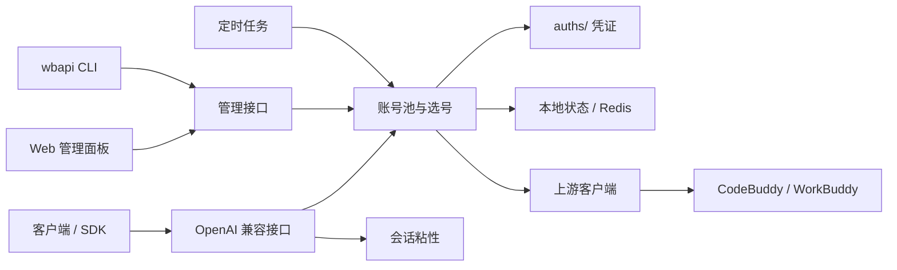

# 核心能力

[← 返回 README](../README.md)

## 账号池与选号

- **多账号轮转**：同一网关管理多个国内版和国际版账号。
- **加权选择**：综合积分、快过期积分和闲置时间分配流量。
- **在途限制**：限制单账号并发，避免一个账号过载。
- **成本分层**：按账号与模型的实际成本优先选择免费或低成本账号。
- **条件探索**：未知成本的账号通过真实用户请求逐步学习，不额外制造探测请求。
- **会话粘性**：同一对话优先使用同一账号，减少上下文跳转和缓存失效。

选号顺序为：

```text
会话粘性 -> 成本分层 -> 加权随机
```

## 稳定性

- 429 使用指数软冷却，并按模型分别记录。
- 连续失败会触发熔断，恢复后自动回到候选池。
- 积分耗尽、鉴权失败和重复失败使用不同错误分类。
- 手动停用与系统禁用是两个独立状态，避免自动任务错误恢复人工操作。
- 池状态、冷却、请求日志和统计定期原子落盘。
- Upstash Redis 可用于镜像状态，未配置时完全使用本地文件。

## OpenAI 兼容请求

- 支持流式 SSE 和非流式响应。
- 出站请求统一转换为上游支持的标准 OpenAI 形态。
- 支持工具调用、图片消息、推理内容和常见字段别名。
- 兼容 AI-SDK、ZCode、Codex 和其他 OpenAI SDK 的请求差异。
- 支持 `cn:` 和 `global:` 模型前缀，由网关选择对应域的账号。
- 对孤立 tool 消息、`developer` 角色和 `tool_choice` 做兼容归一。

## 提示词模式

`prompt.mode` 支持三种模式：

| 模式 | 行为 |
| --- | --- |
| `passthrough` | 保留客户端 system/developer 提示词 |
| `custom` | 使用网关提示词替换客户端提示词 |
| `append` | 保留客户端提示词并追加网关提示词 |

`prompt.file` 可以指定自定义提示词文件。不指定时使用内置提示词。

## 定时任务

网关可以独立安排六类任务：

| 任务 | 默认时点 | 作用 |
| --- | --- | --- |
| 签到 | 09:00、21:00 | 每日签到并刷新余额 |
| 活跃地图 | 10:00 | 活跃上报、连登和礼包 |
| 猫猫旅行 | 09:00、21:00 | 领养、派出和领奖 |
| Token 保活 | 22:00 | 刷新账号 token |
| 开学季 | 12:00 | 完成任务和抽奖 |
| 夜猫子 | 01:00 | 夜间任务 |

各任务可独立关闭，也可以从管理面板或 `wbapi task` 手动执行。任务在进程内以
Go 执行，不依赖外部脚本；Android 模块默认关闭自动调度，手动触发不受影响。

## 双域支持

网关同时支持：

- 国内版：`copilot.tencent.com` 与 `www.codebuddy.cn`
- 国际版：`www.workbuddy.ai`

账号的 `realm` 字段决定实际请求域。模型名前的 `cn:` 或 `global:` 前缀可以显式选择域。
设置 `global.enabled=false` 可以把部署锁定为纯国内版。

## 管理面与工具

- 内置 Vue 管理面板。
- 多 key 调用鉴权。
- `wbapi` Go CLI 覆盖状态、诊断、账号、任务、密钥、日志和服务管理。
- `login` 完成 OAuth 设备授权并写入凭证。
- `signin`、`credit`、`acct`、`trial` 等兼容命令由 Go 构建器生成。
- Unix 兼容命令名如 `login.sh` 也是 Go 可执行文件，不依赖 Shell。

CLI 帮助见[管理后台与 CLI](admin.md)。

## 数据文件

运行目录通常包含：

| 路径 | 内容 |
| --- | --- |
| `config.json` | 网关配置 |
| `keys.json` | 多调用 key |
| `auths/` | 账号凭证 |
| `data/state.json` | 池状态 |
| `data/requests.json` | 最近请求日志 |
| `data/metrics.json` | 请求统计 |
| `gateway.log` | Windows 服务日志 |

凭证、密钥和状态文件不应提交到 Git。

## 架构



管理面板中的模型对话不是旁路，它会经过同一套鉴权、选号、冷却、日志和统计链路。
